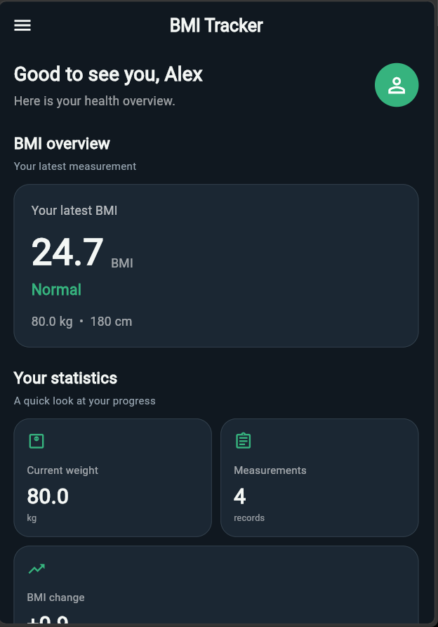
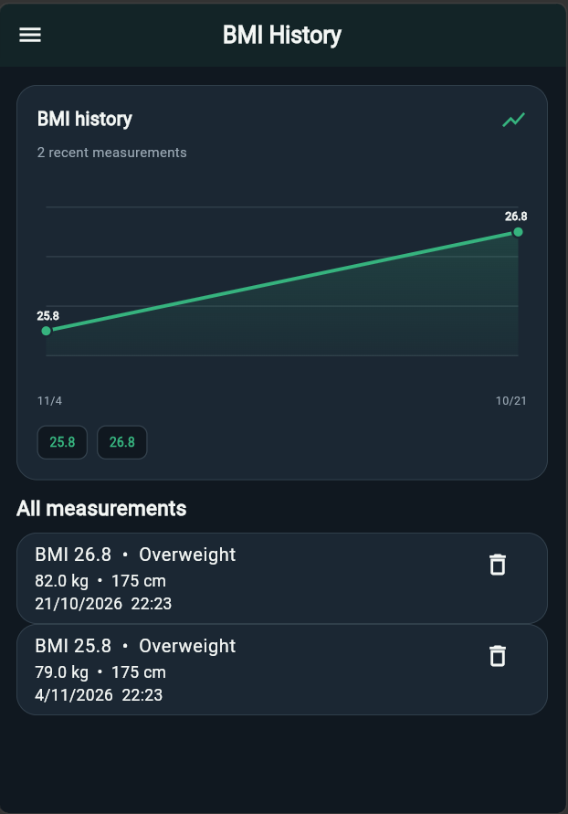
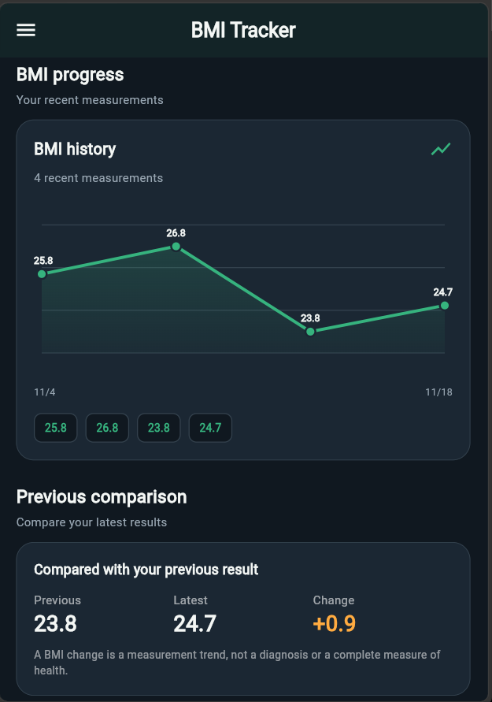
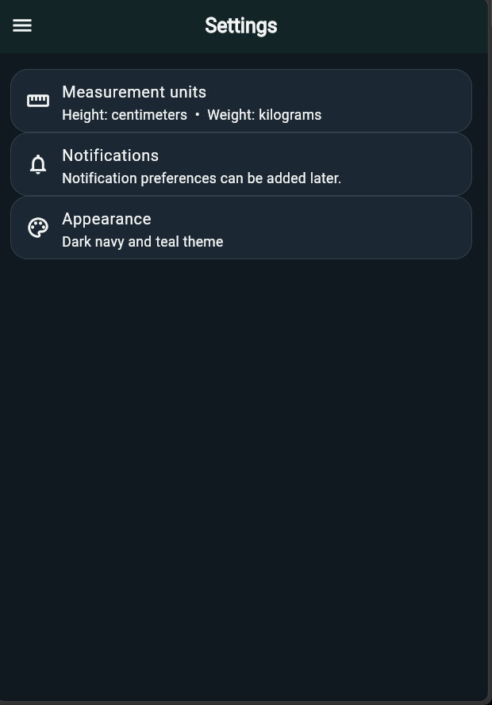

# BMI Calculator

A modern **BMI (Body Mass Index) Calculator** built with **Flutter and Dart**. This application provides a clean health-focused dashboard where users can calculate their BMI, review previous results, and track changes over time.

## Features

- **BMI Calculation:** Calculate Body Mass Index using height and weight.
- **Health Dashboard:** View BMI results and related information.
- **BMI History:** Review previously calculated BMI records.
- **Result Comparison:** Compare your latest BMI result with previous records.
- **BMI Chart:** Visualize BMI information.
- **Profile Management:** View and manage user profile information.
- **Settings:** Access application settings.
- **About Screen:** View information about the application.
- **Dark Theme:** Consistent, modern health-tech interface.

## Screenshots

| Home | History |
|:---:|:---:|
|  |  |

| Comparison | Profile |
|:---:|:---:|
|  |  |

| Settings |
|:---:|
|  |

## Tech Stack

- **Flutter** – Cross-platform UI framework.
- **Dart** – Application programming language.
- **Material Design** – UI components and styling.

## Project Structure

```text
lib/
├── bars/
├── models/
├── screens/
├── services/
├── theme/
├── widgets/
└── main.dart
```

### Architecture

The project uses a modular structure to separate responsibilities:

- `models/` – Data models for users and BMI records.
- `screens/` – Application screens.
- `services/` – Services for managing user and BMI data.
- `theme/` – Application theme and color configuration.
- `widgets/` – Reusable UI components.
- `bars/` – Custom interface components.

## Getting Started

### Prerequisites

- Flutter SDK
- Dart SDK
- Visual Studio Code or Android Studio
- An Android emulator or physical device

### Installation

1. Clone the repository:

```bash
git clone https://github.com/ARK13-org/Flutter-Bmi-Calculator.git
```

2. Navigate to the project directory:

```bash
cd Flutter-Bmi-Calculator
```

3. Install dependencies:

```bash
flutter pub get
```

4. Run the application:

```bash
flutter run
```

## Current Implementation

The current version uses mock services for BMI records and user information. Data is managed locally in memory and is not permanently stored.

A FastAPI backend is planned as a separate development phase.

## Disclaimer

BMI is a general screening measurement and does not independently determine an individual's health. This application is intended for educational and informational purposes, not as a substitute for professional medical advice.

## Author

**ARK13-org**

GitHub: [ARK13-org](https://github.com/ARK13-org)
