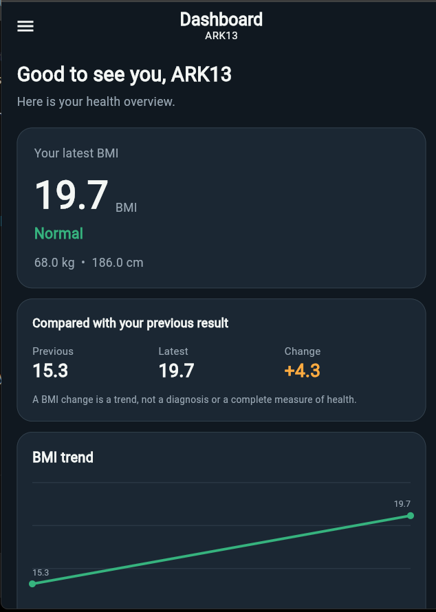
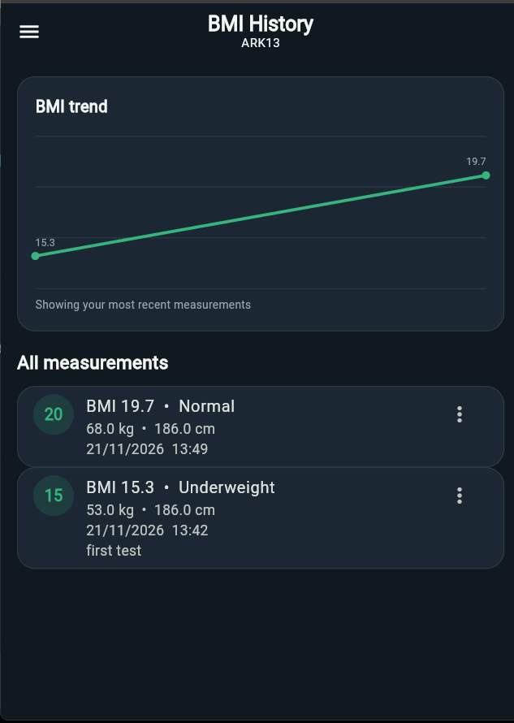
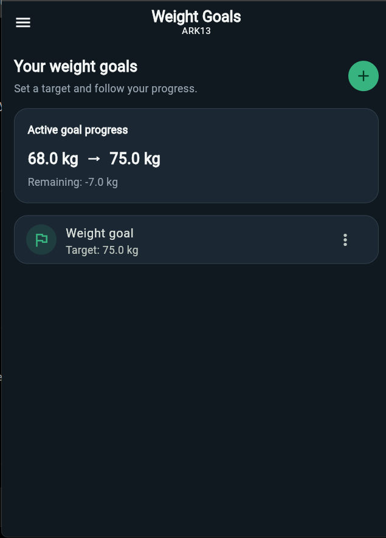
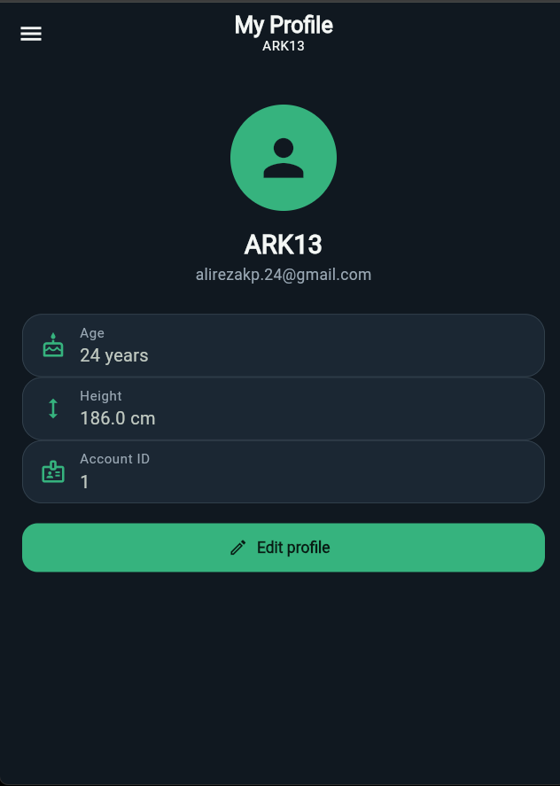
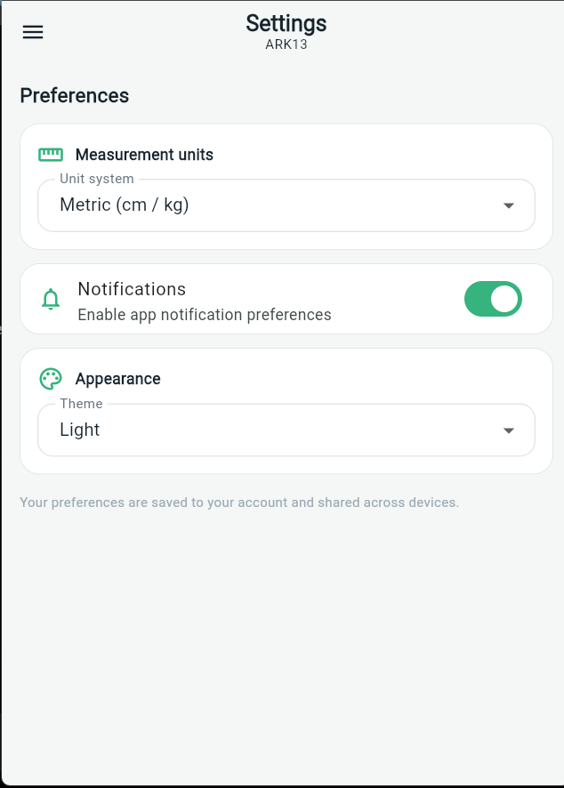
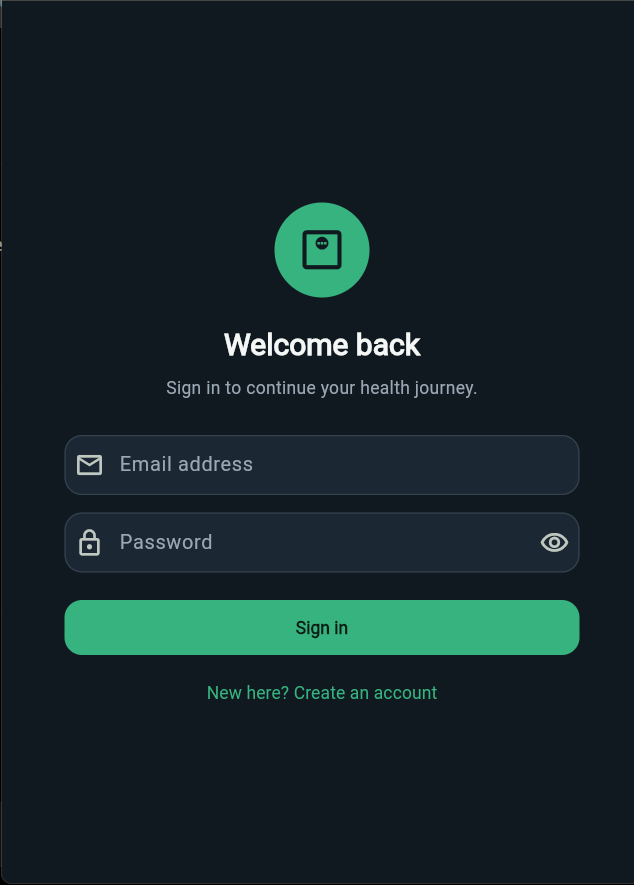

# BMI Calculator — Flutter App

A modern, full-stack BMI tracking application built with **Flutter** and **FastAPI**. The application helps users calculate and track their Body Mass Index (BMI), monitor measurement history, compare results, manage personal goals, and view health-related statistics.

Featuring a clean, dark health-tech interface, secure authentication, interactive charts, and persistent cloud-ready API integration.

## Screenshots

| Dashboard | BMI History |
|:---:|:---:|
|  |  |

| Goals | Profile |
|:---:|:---:|
|  |  |

| Settings | Authentication |
|:---:|:---:|
|  |  |

## Features

### Authentication and User Management
- User registration and login.
- JWT-based authentication.
- Persistent authentication sessions.
- User profile management.
- Update personal information.

### BMI Tracking
- Calculate BMI using height and weight.
- Automatically categorize BMI results.
- Save multiple BMI measurements.
- View complete measurement history.
- Edit and delete existing records.
- Compare current and previous BMI results.

### Dashboard and Statistics
- Personalized dashboard.
- Latest BMI result and category.
- Comparison with previous measurements.
- Interactive BMI trend charts.
- Measurement statistics.

### Goal Management
- Create personal weight goals.
- Track goal progress.
- Activate and deactivate goals.
- Update and delete goals.

### Settings and Customization
- Metric and imperial unit systems.
- Dark, light, and system theme preferences.
- Notification preference settings.

## Technologies

### Frontend
- Flutter
- Dart
- Material Design
- HTTP
- Shared Preferences

### Backend
- Python
- FastAPI
- SQLAlchemy
- SQLite
- Pydantic
- JWT Authentication
- Uvicorn

## Architecture

This project uses a client-server architecture.

```text
Flutter Application
        |
        | HTTP / REST API
        |
        v
FastAPI Backend
        |
        v
SQLAlchemy ORM
        |
        v
SQLite Database
```

The Flutter application communicates with the FastAPI backend through REST API endpoints. Authentication, user profiles, BMI records, goals, and settings are managed through the backend.

**Backend Repository:**  
[ BMI Calculator API — GitHub ](https://github.com/ARK13-org/BMI-Calculator-API)

## Getting Started

### Prerequisites

- Flutter SDK
- Dart SDK
- Python 3.10+
- Git
- Android Studio or Visual Studio Code

### 1. Clone the Repository

```bash
git clone https://github.com/ARK13-org/Flutter-Bmi-Calculator.git
cd Flutter-Bmi-Calculator
```

### 2. Install Flutter Dependencies

```bash
flutter pub get
```

### 3. Configure the Backend

Clone and configure the backend separately:

```bash
git clone https://github.com/ARK13-org/BMI-Calculator-API.git
cd BMI-Calculator-API
```

Create and activate a Python virtual environment, then install dependencies:

```powershell
py -m venv .venv
.\.venv\Scripts\Activate.ps1
pip install -r requirements.txt
```

Create a `.env` file using `.env.example` and configure your environment variables.

Start the backend:

```bash
python -m uvicorn app.main:app --reload
```

The API will be available at:

```text
http://127.0.0.1:8000
```

Interactive API documentation:

```text
http://127.0.0.1:8000/docs
```

### 4. Configure the API URL

The Flutter application supports API URL configuration through `--dart-define`.

**Flutter Web / Localhost:**

```bash
flutter run -d chrome --dart-define=API_BASE_URL=http://127.0.0.1:8000/api/v1
```

**Android Emulator:**

```bash
flutter run --dart-define=API_BASE_URL=http://10.0.2.2:8000/api/v1
```

**Physical Android Device:**

Replace the IP address with your computer's local IPv4 address:

```bash
flutter run --dart-define=API_BASE_URL=http://192.168.1.20:8000/api/v1
```

The backend must be accessible from the device. For physical Android devices, run Uvicorn with `--host 0.0.0.0` and configure the appropriate firewall and network permissions.

For Flutter Web, configure the backend's CORS origins to include the actual Flutter Web origin.

## Testing and Code Quality

The application has been tested with the real FastAPI backend.

Verified functionality includes:

- User registration and login.
- Profile updates.
- Creating and retrieving BMI measurements.
- Editing and deleting BMI records.
- BMI history and charts.
- BMI comparisons.
- Data persistence after browser refresh.
- Backend integration and API communication.

Code analysis:

```bash
flutter analyze
```

Result: No issues found.

Automated tests:

```bash
flutter test
```

Result: All tests passed.

## Project Structure

```text
lib/
├── models/
├── screens/
├── services/
├── theme/
├── utils/
├── widgets/
└── main.dart

assets/
└── screenshots/

test/
```

## Project Information

**Project:** BMI Calculator  
**Frontend:** Flutter & Dart  
**Backend:** FastAPI & Python  
**Database:** SQLite  
**Architecture:** Client-Server REST API  
**Platforms:** Android and Web

## Disclaimer

BMI is a general screening measure and is not a medical diagnosis. BMI categories should not be used as the sole indicator of an individual's health.

---

Developed as a full-stack portfolio project using Flutter and FastAPI.
